# tMC — turn a map into a Minecraft world

**English** · [Русский](README.ru.md)

tMC takes a piece of a real map and builds a **Minecraft Java Edition** world from it, so you can walk through your own town block by block.
Download the release, unpack it, run `tMC.exe` — nothing has to be installed (Windows, 64-bit).

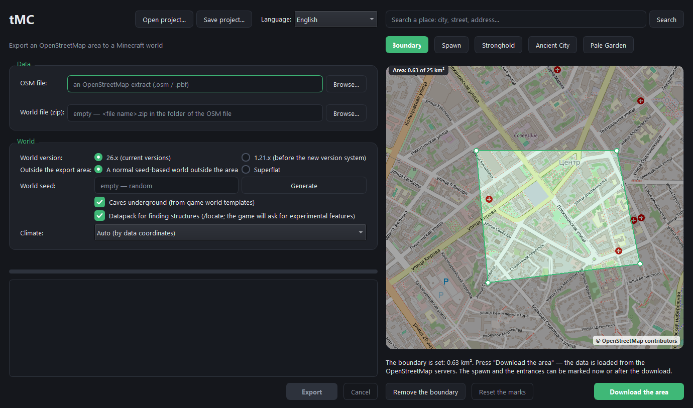

## What you get

- **Buildings** with floors, windows, doors, interiors (rooms, stairs, furniture) and roofs; the height, the number of floors and the material come from the map data. Schools, kindergartens, research institutes and churches have their own look.
- **Roads** with marking and crosswalks, bridges over water, railways, street lamps, signs with street names and house numbers.
- **Nature**: water, forests of the species that fit the climate zone, parks, yards, fields (wheat grows on plowed soil), relief.
- **Underground and hidden things**: caves, church and laboratory dungeons, a stronghold and an Ancient City with secret passages, a Pale Garden with a mansion, bandit outposts and camps, shipwrecks in big lakes, ruined portals, floating islands above parks, villages made from clusters of private houses.
- Villagers, mannequins, furniture and chests with ordinary game loot.
- The result is a normal save (a `.zip`): put it into `.minecraft/saves`, with or without unpacking. Versions **26.x** and **1.21.x** are supported; outside the exported area you get either a normal seed-based world or a superflat one.

## Quick start

1. Run `tMC.exe`. On the right is the online OpenStreetMap map; find a place with the search field.
2. Press **Boundary** and click out the polygon of the area you want, up to **25 km²** (the area is shown in the corner of the map).
3. Optionally mark the **Spawn** point and the entrances of the **Stronghold**, the **Ancient City** and the **Pale Garden**.
4. Press **Download the area** — the data is loaded from the OpenStreetMap servers and opens in the window.
5. Choose the world options on the left and press **Export**. The result is `<name>.zip` next to the OSM file; when it is done, the *Show the file in the folder* checkbox opens it in Explorer.

Instead of the online map you can use a file: type or browse for an OpenStreetMap extract (`.osm`, `.pbf`) in the *OSM file* field. Clearing the field brings the online map back.

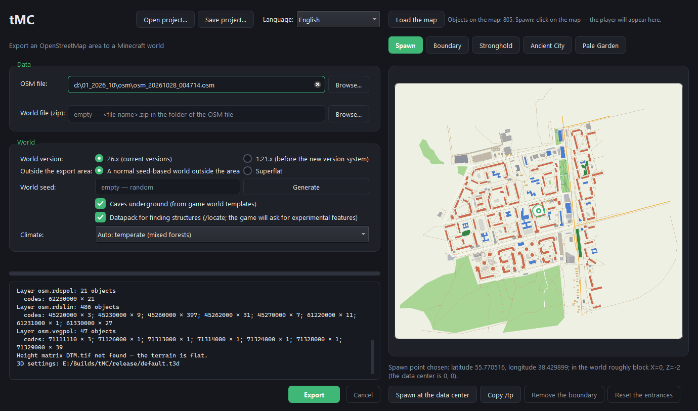

## Gallery

Pictures of a world made by tMC (click a preview to open the full size).

<table>
<tr><td align="center" width="33%"><a href="images/shots/01_library.jpg">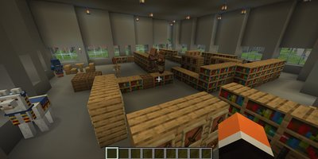</a><br><sub>A library with bookshelves and reading tables</sub></td><td align="center" width="33%"><a href="images/shots/02_classroom.jpg">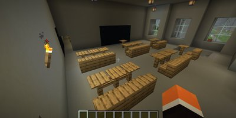</a><br><sub>A classroom: desks and a blackboard</sub></td><td align="center" width="33%"><a href="images/shots/03_park.jpg">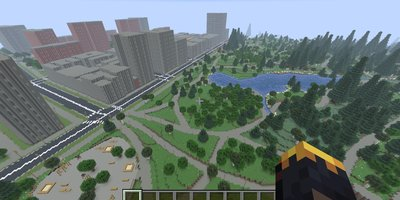</a><br><sub>A park with a lake and an avenue</sub></td></tr>
<tr><td align="center" width="33%"><a href="images/shots/04_hall.jpg">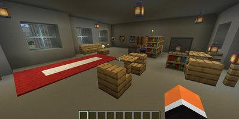</a><br><sub>A hall with lanterns and a carpet</sub></td><td align="center" width="33%"><a href="images/shots/05_desert.jpg">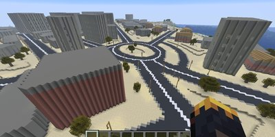</a><br><sub>A city in the desert climate zone</sub></td><td align="center" width="33%"><a href="images/shots/06_church.jpg">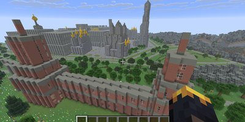</a><br><sub>A brick church complex with golden domes</sub></td></tr>
<tr><td align="center" width="33%"><a href="images/shots/07_playroom.jpg">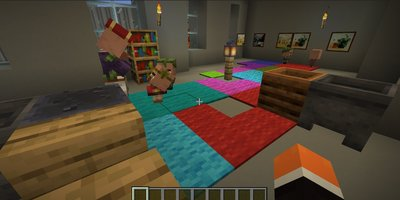</a><br><sub>A playroom of a kindergarten with villagers</sub></td><td align="center" width="33%"><a href="images/shots/08_school.jpg">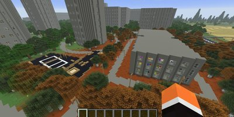</a><br><sub>A school among a motley forest</sub></td><td align="center" width="33%"><a href="images/shots/09_avenue.jpg">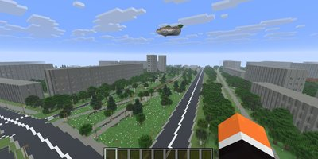</a><br><sub>An avenue and a floating island above the park</sub></td></tr>
<tr><td align="center" width="33%"><a href="images/shots/10_blocks.jpg">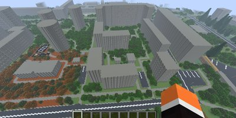</a><br><sub>Residential blocks and courtyards</sub></td><td align="center" width="33%"><a href="images/shots/11_towers.jpg">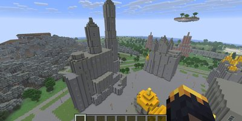</a><br><sub>Towers and churches (Moscow)</sub></td><td align="center" width="33%"><a href="images/shots/12_caves.jpg">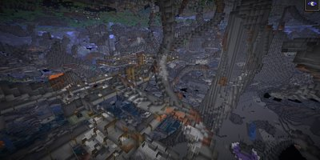</a><br><sub>Real game caves under the city</sub></td></tr>
<tr><td align="center" width="33%"><a href="images/shots/13_dungeon.jpg">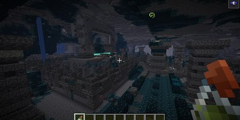</a><br><sub>Full-fledged structures in the caves (an Ancient City)</sub></td><td align="center" width="33%"><a href="images/shots/14_night.jpg">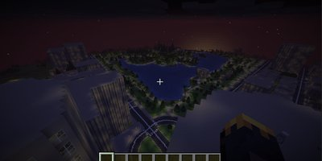</a><br><sub>The city at night</sub></td><td align="center" width="33%"><a href="images/shots/15_seamless.jpg">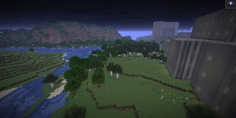</a><br><sub>Seamless world generation: the real terrain continues around the exported area</sub></td></tr>
</table>

## The window

| Element | What it does |
|---|---|
| **OSM file** | An OpenStreetMap extract on your disk; empty — the online map. |
| **World file (zip)** | Where to write the result; empty — next to the OSM file. |
| **World version** | 26.x (current) or 1.21.x. |
| **Outside the export area** | A normal seed-based world around the area, or a superflat one. |
| **World seed** | Empty — random; *Generate* picks one. |
| **Caves underground** | Caves from templates of a real game world. |
| **Datapack for finding structures** | Lets `/locate` and the Eye of Ender find the stronghold, the Ancient City, trial chambers and ruined portals. The game asks about experimental features when it opens such a world; the structures exist without the datapack, they just cannot be found with a command. |
| **Climate** | Biomes, ground and trees by climate zone; *Auto* detects it from the coordinates. |
| **Boundary, Spawn, Stronghold, Ancient City, Pale Garden** | Tools on the map: draw the area, place the player's spawn, set the secret entrances. *Remove the boundary* and *Reset the marks* undo them; *Copy /tp* copies the teleport command to the marked point. |
| **Open project… / Save project…** | Save and restore your work (map view, boundary, marks, options) in a `.tmc` file. |
| **Language** | English or Russian, switches at once; by default the system language is used. |

While the export runs, the log shows the progress; **Cancel** stops it. Only what is inside the boundary is exported (a building or a lake at the edge is kept whole).

## Tips

- Start with a small area (1–2 km²): the export takes minutes, a big one takes much longer and needs more memory.
- The result depends on how well the area is mapped in OpenStreetMap: heights, floors and building types appear only where mappers entered them; where they are missing, tMC estimates them.
- If you publish a world made from OpenStreetMap data (a server, a download), keep the attribution — see *License and data* below.

## Command line

For scripts there is a mode without a window:

```
tMC source.osm -o world.zip --nogui --log run.log
```

Main options: `--format 26|1.21`, `--flat`, `--seed N`, `--caves 0|1`, `--climate auto|temperate|boreal|tundra|steppe|mediterranean|desert|savanna|tropical`,
`--clip "lon lat; lon lat; ..."` (export only this polygon), `--spawn-lonlat "lon lat"`, `--lang auto|en|ru`, `--theme auto|light|dark`,
`--download-osm "lon lat; ..." -o area.osm` (download an area of up to 25 km² and exit), `--dry-run` (only load and classify the data). `tMC --help` lists everything.
A `.tmc` project file passed as the argument opens in the window.

## Tuning

These files lie next to `tMC.exe` and can be edited with any text editor:

- **`osm_rules.json`** — which OpenStreetMap tags make which kind of object; the format is described inside the file (the `_help` section).
- **`default.t3d`** — the 3D settings: materials, heights, the look of object types.
- **`heights.csv`** — typical building heights by type, used when the map has none.
- **`tmc_buildings.dat`** — building points (type, height, floors) used only when OpenStreetMap does not give them; the values in it are deliberately rough.

## License and data

tMC is free software under the **MIT license** (`LICENSE`); the third-party components shipped with it are listed in `THIRD_PARTY_NOTICES.md`. The program icon is made from the Minecraft Wiki logo by Oakar567 and is under **CC BY-SA 3.0** (details are in the same file).

Map data © **OpenStreetMap contributors**, under the Open Database License (ODbL) — https://www.openstreetmap.org/copyright.
**A world made from OSM data is a derived database: when you publish it (a server, a download), keep the attribution "Map data © OpenStreetMap contributors (ODbL)" and follow the ODbL.** The exported zip contains the file `ATTRIBUTION.txt` with this line.
The online mode follows the OpenStreetMap usage policies: tiles are cached, searches go out at most once per second. Please do not abuse the public servers.

Minecraft is a trademark of Mojang AB; tMC is not affiliated with Mojang or Microsoft. The structure templates were cut out of a game world.

Source code, issues and releases: https://github.com/mrHalfer/tMC. How to build the program: [DEVELOPING.md](DEVELOPING.md).
