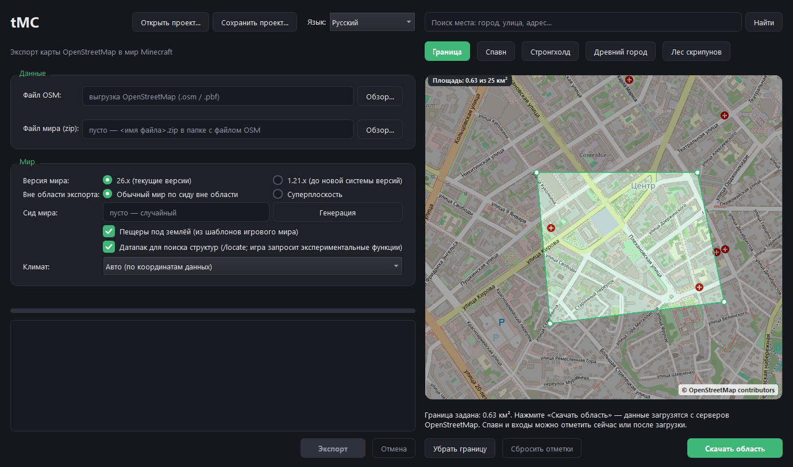
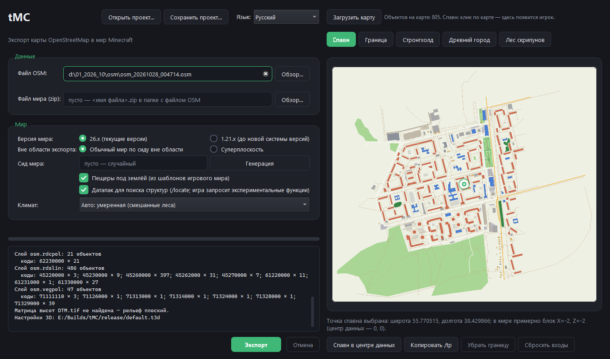
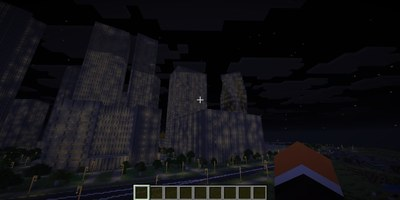
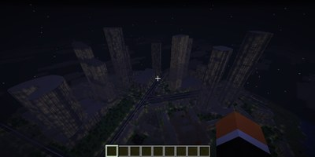
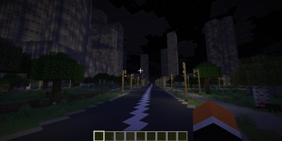

# tMC — твой мир в Minecraft

[English](README.md) · **Русский**

tMC в пару кликов превратит карту в мир **Minecraft Java Edition**: вы сможете пройтись по родному городу, блок за блоком. Программа полностью готова к использованию. Никаких лишних зависимостей.



## Быстрый старт

1. Скачайте релиз и запустите `tMC.exe`. Справа - онлайн-карта OpenStreetMap со строкой поиска любого места на любом языке.
2. Нажмите **Граница** и обведите многоугольник нужной области, не больше **25 км²** (площадь показана в углу карты).
3. По желанию отметьте точку **Спавн** и входы в **Стронгхолд**, **Древний город** и **Лес скрипунов**.
4. Нажмите **Скачать область** - данные загрузятся с серверов OpenStreetMap и откроются в окне.
5. Выберите параметры мира слева и нажмите **Экспорт**. Результат - `<имя>.zip` рядом с OSM-файлом; после завершения флажок *Показать файл в папке* откроет его в Проводнике.

Вместо онлайн-карты можно взять файл: введите путь к выгрузке OpenStreetMap (`.osm`, `.pbf`) или выберите её в поле *Файл OSM*. Если очистить поле, вернётся онлайн-карта.



## Что получится

- **Здания** с этажами, окнами, дверями, интерьерами (комнаты, лестницы, мебель) и крышами; высота, этажность и материал берутся из данных карты. У школ, детских садов, НИИ и церквей свой облик и уникальные интерьеры.
- **Дороги** с разметкой и зеброй, мосты через воду, железные дороги, уличные фонари, таблички с названиями улиц и номерами домов.
- **Природа**: вода, леса, климатические зоны, парки, дворы, поля, рельеф - все как в реальной жизни, только лучше.
- **Под землёй и скрытое**: пещеры, подземелья церквей и лабораторий, стронгхолд и Древний город с секретными ходами, лес скрипунов с особняком, аванпосты и лагеря разбойников, кораблекрушения в больших озёрах, руины порталов, парящие острова над парками, деревни из скоплений частных домов.
- Жители, манекены, мебель и сундуки с обычным игровым лутом.
- Результат - обычное сохранение (`.zip`): положите его в `.minecraft/saves`, можно не распаковывая. Поддерживаются версии **26.x** и **1.21.x**; вне области экспорта будет либо обычный мир по сиду, либо суперплоский.

## Окно программы

| Элемент | Что делает |
|---|---|
| **Файл OSM** | Выгрузка OpenStreetMap на диске; пусто - онлайн-карта. |
| **Файл мира (zip)** | Куда записать результат; пусто - рядом с файлом OSM. |
| **Версия мира** | 26.x (текущая) или 1.21.x. |
| **Вне области экспорта** | Обычный мир по сиду вокруг области или суперплоский. |
| **Сид мира** | Пусто - случайный; *Генерация* подбирает его. |
| **Пещеры под землёй** | Пещеры из шаблонов настоящего игрового мира. |
| **Датапак для поиска структур** | Позволяет `/locate` и глазу Эндера находить стронгхолд, Древний город, пещеры испытаний и руины порталов. При открытии такого мира игра спросит про экспериментальные функции; без датапака структуры всё равно есть, но командой их не найти. |
| **Климат** | Биомы, поверхность и деревья по климатической зоне; *Авто* определяет её по координатам. |
| **Граница, Спавн, Стронгхолд, Древний город, Лес скрипунов** | Инструменты на карте: обвести область, поставить спавн игрока, задать секретные входы. *Убрать границу* и *Сбросить входы* отменяют их; *Копировать /tp* копирует команду телепорта в отмеченную точку. |
| **Открыть проект… / Сохранить проект…** | Сохраняют и восстанавливают работу (положение карты, границу, отметки, параметры) в файле `.tmc`. |
| **Язык** | Английский или русский, переключается сразу; по умолчанию берётся язык системы. |

Пока идёт экспорт, в журнале виден ход работы; **Отмена** останавливает его. Экспортируется только то, что внутри границы (здание или озеро на краю сохраняются целиком).

## Галерея

Кадры из мира, сделанного tMC (нажмите на превью, чтобы открыть в полном размере).

<table>
<tr><td align="center" width="33%"><a href="images/shots/01_library.jpg"></a><br><sub>Библиотека со стеллажами и читальными столами</sub></td><td align="center" width="33%"><a href="images/shots/02_classroom.jpg"></a><br><sub>Класс: парты и доска</sub></td><td align="center" width="33%"><a href="images/shots/03_park.jpg"></a><br><sub>Парк с озером и аллея</sub></td></tr>
<tr><td align="center" width="33%"><a href="images/shots/04_hall.jpg"></a><br><sub>Зал с фонарями и ковровой дорожкой</sub></td><td align="center" width="33%"><a href="images/shots/05_desert.jpg"></a><br><sub>Город в пустынной климатической зоне</sub></td><td align="center" width="33%"><a href="images/shots/06_church.jpg"></a><br><sub>Кирпичный храмовый комплекс с золотыми куполами</sub></td></tr>
<tr><td align="center" width="33%"><a href="images/shots/07_playroom.jpg"></a><br><sub>Игровая комната детского сада с жителями</sub></td><td align="center" width="33%"><a href="images/shots/08_school.jpg"></a><br><sub>Школа среди пёстрого леса</sub></td><td align="center" width="33%"><a href="images/shots/09_avenue.jpg"></a><br><sub>Проспект и парящий остров над парком</sub></td></tr>
<tr><td align="center" width="33%"><a href="images/shots/10_blocks.jpg"></a><br><sub>Жилые кварталы и дворы</sub></td><td align="center" width="33%"><a href="images/shots/11_towers.jpg"></a><br><sub>Башни и храмы (Москва)</sub></td><td align="center" width="33%"><a href="images/shots/12_caves.jpg"></a><br><sub>Настоящие игровые подземелья под городом</sub></td></tr>
<tr><td align="center" width="33%"><a href="images/shots/13_dungeon.jpg"></a><br><sub>Полноценные структуры в подземельях (Древний город)</sub></td><td align="center" width="33%"><a href="images/shots/14_night.jpg"></a><br><sub>Ночной город</sub></td><td align="center" width="33%"><a href="images/shots/15_seamless.jpg"></a><br><sub>Бесшовная генерация мира: настоящий рельеф продолжается вокруг области экспорта</sub></td></tr>
<tr><td align="center" width="33%"><a href="images/shots/16_night_towers.jpg"></a><br><sub>Ночной город: освещённые окна башен</sub></td><td align="center" width="33%"><a href="images/shots/17_night_aerial.jpg"></a><br><sub>Ночной вид на кварталы сверху</sub></td><td align="center" width="33%"><a href="images/shots/18_night_road.jpg"></a><br><sub>Ночной проспект с фонарями</sub></td></tr>
</table>

## Советы

- Начните с небольшой области (1–2 км²): экспорт занимает минуты, большая область - намного дольше и требует больше памяти.
- Результат зависит от того, насколько хорошо область нарисована в OpenStreetMap: высоты, этажность и типы зданий есть только там, где их указали участники; где их нет, tMC оценивает их сам.
- Если вы публикуете мир, сделанный из данных OpenStreetMap (сервер, скачивание), сохраняйте подпись - см. раздел *Лицензия и данные*.

## Командная строка (pro-режим)

Для скриптов есть режим без окна:

```
tMC источник.osm -o мир.zip --nogui --log run.log
```

Основные ключи: `--format 26|1.21`, `--flat`, `--seed N`, `--caves 0|1`, `--climate auto|temperate|boreal|tundra|steppe|mediterranean|desert|savanna|tropical|monsoon|semi-arid|rainforest|dark-forest`,
`--clip "lon lat; lon lat; ..."` (экспортировать только этот многоугольник), `--spawn-lonlat "lon lat"`, `--lang auto|en|ru`, `--theme auto|light|dark`,
`--download-osm "lon lat; ..." -o область.osm` (скачать область до 25 км² и выйти), `--dry-run` (только загрузить и классифицировать данные). Полный список - `tMC --help`.
Файл проекта `.tmc`, переданный аргументом, открывается в окне.

## Настройка (для настоящих гуру)

Эти файлы лежат рядом с `tMC.exe` и правятся любым текстовым редактором:

- **`osm_rules.json`** - какие теги OpenStreetMap дают какой вид объекта; формат описан внутри файла (раздел `_help`).
- **`default.t3d`** - настройки 3D: материалы, высоты, облик типов объектов.
- **`heights.csv`** - типовые высоты зданий по типам, используются, когда на карте высоты нет.
- **`tmc_buildings.dat`** - точки зданий (тип, высота, этажность), используются только когда OpenStreetMap их не даёт; значения в нём намеренно приблизительные.

## Лицензия и данные

tMC - свободная программа под лицензией **MIT** (`LICENSE`); сторонние компоненты, поставляемые вместе с ней, перечислены в `THIRD_PARTY_NOTICES.md`. Иконка программы сделана из логотипа Minecraft Wiki (автор Oakar567) и распространяется по лицензии **CC BY-SA 3.0** (подробности - в том же файле).

Картографические данные © участники **OpenStreetMap** по лицензии Open Database License (ODbL) - https://www.openstreetmap.org/copyright.
**Мир, сделанный из данных OSM, - производная база данных: если вы его публикуете (сервер, скачивание), сохраняйте подпись «Map data © OpenStreetMap contributors (ODbL)» и соблюдайте ODbL.** В экспортированном zip лежит файл `ATTRIBUTION.txt` с этой строкой.
Онлайн-режим следует правилам OpenStreetMap: тайлы кэшируются, поиск идёт не чаще раза в секунду. Не злоупотребляйте публичными серверами.

Minecraft - товарный знак Mojang AB; tMC не связан с Mojang и Microsoft. Шаблоны структур вырезаны из игрового мира.

Исходный код, ошибки и релизы: https://github.com/mrHalfer/OSM2MC. Как собрать программу: [DEVELOPING.md](DEVELOPING.md).
